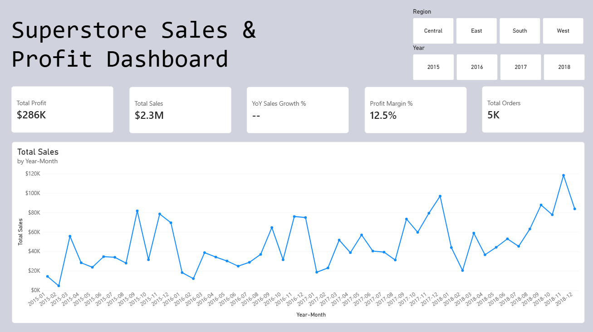
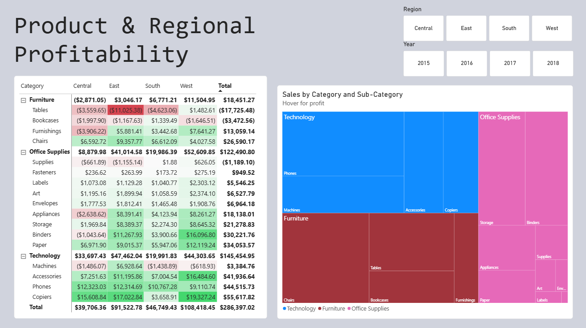

# Superstore Executive Sales & Profit Dashboard (Power BI)

## Executive Summary
I built a two-page interactive Power BI dashboard on four years of Superstore retail data (January 2015 to December 2018): $2.30M in sales, $286K in profit, a 12.5% margin and 5,009 orders. The dashboard lets an executive filter by year and region and see, at a glance, how sales trend over time and which products and regions make or lose money. The main finding is that profit is concentrated in Technology and Office Supplies, while Furniture earns almost nothing and the Tables sub-category loses money.

## Business Problem
Management needs one place to answer four questions: How are sales and profit performing overall? How do they change month to month and year to year? Which categories and sub-categories drive profit? Which regions and product combinations are losing money? Raw order records can't answer these quickly, so I turned them into KPI scorecards, a monthly trend and a profitability breakdown that respond to filters.

## Methodology
**Data preparation.** I started from the cleaned orders table from my Python EDA project, together with the People and Returns tables that were originally stacked in the same file. In Power Query I set data types and restored five-digit postal codes (leading zeros had been lost).

**Star schema.** I used a staging query and split it into a fact table and dimension tables: `FactOrders` (sales, profit, quantity, dates, keys), `DimCustomer`, `DimProduct` and a `DimDate` calendar table built in DAX and marked as the date table. `People` and `Returns` are linked as additional tables. All relationships are one-to-many with single-direction filtering.

**DAX measures.**
- `Total Sales`, `Total Profit` and `Total Orders` (a distinct count of Order ID)
- `Profit Margin %` using `DIVIDE`, to avoid division-by-zero errors
- `Sales PY` and `YoY Sales Growth %` using `SAMEPERIODLASTYEAR`, which only appears when a single year is selected

**Validation.** I checked the dashboard totals against my Python results, and Sales ($2,297,201) and Profit ($286,397) match exactly.

**Report design.**
- *Page 1, Executive Overview:* KPI cards (Profit, Sales, YoY Growth, Margin, Orders), a monthly sales line chart, and Year and Region button slicers.
- *Page 2, Product & Regional Profitability:* a Category and Sub-Category treemap sized by sales, and a matrix of profit by Sub-Category and Region with red-to-green conditional formatting.
- The slicers are synced across both pages.

## Skills
Power BI Desktop, Power Query, star-schema data modeling, DAX (CALCULATE, SAMEPERIODLASTYEAR, DIVIDE, DISTINCTCOUNT, calendar tables), time intelligence, conditional formatting, interactive dashboard design, data validation, communicating business insights.

## Results and Business Recommendations
**Sales are growing and seasonal.** Each year follows the same pattern: weak in January and February, and a strong run from September to a peak in November and December. November 2018 was the best month at about $118K. I would plan inventory and staffing around the year-end peak.

**Technology and Office Supplies carry the profit.** Technology earns $145K and Office Supplies $122K, while Furniture earns only $18K on a much larger sales base. Copiers ($56K), Phones ($45K) and Accessories ($42K) are the strongest sub-categories.

**Tables is the biggest problem product.** The Tables sub-category loses about $17.7K in total, and most of that comes from the East region (about -$11.0K) and Central (-$3.6K). Bookcases (-$3.5K) and Supplies (-$1.2K) also lose money overall. I would review pricing and discounting on Tables before pushing more volume there.

**Central Furniture is the only loss-making region and category pair** at -$2.9K, which is consistent with the deep discounting I found in my EDA project.

**West and East lead on profit** ($108K and $92K), while Central trails at $40K despite sizable sales.

## Next Steps
I would add a discount analysis page (profit by discount band), a Returns page using the Returns table to see which categories have the most returned orders, and a regional manager view using the People table. Publishing the report to the Power BI Service would make it shareable as a live dashboard.

## Files
- `superstore_dashboard.pbix`: the Power BI report
- `superstore_dashboard.pdf`: exported two-page report
- `data/`: source CSV files
- `images/`: dashboard screenshots

*Note: the `.pbix` stores the file path of my local data folder. To open it elsewhere, go to Transform data → Data source settings → Change source, and point each source to the matching file in `data/`.*