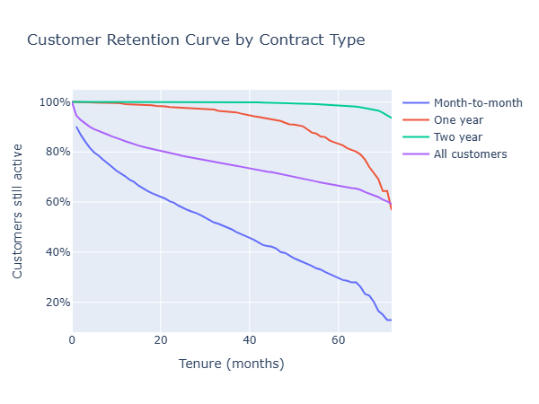
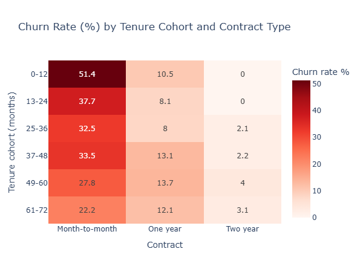
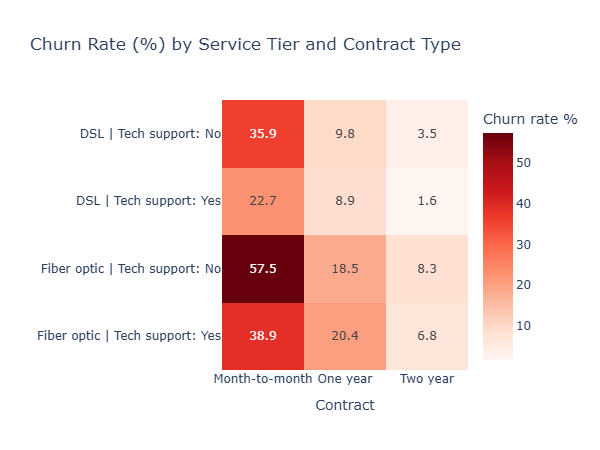

# Customer Cohort and Churn Analytics (IBM Telco Dataset)

## Executive Summary
I analyzed 7,043 customers from the IBM Telco Customer Churn sample dataset to understand who leaves and when. The baseline churn rate is 26.5% (1,869 customers). Churn is concentrated in a small number of segments: customers on month-to-month contracts account for about 89% of churners, and one segment, Fiber optic customers without tech support on month-to-month contracts, is 25.5% of the base but 55.3% of all churn.

## Business Problem
A subscription business loses revenue every time a customer leaves. I set out to answer three questions: how fast does the customer base shrink over time, which contract, payment and service factors separate customers who leave from those who stay, and which segments should a retention team target first.

## Methodology
**Data preparation.** I checked types, duplicates and missing values. `TotalCharges` was stored as text, and 11 blank values turned out to be customers with zero tenure and no churn, so I converted the column to numeric and filled them with 0. I created a binary `ChurnFlag` so that the mean of the flag gives the churn rate for any group.

**Cohorts.** I grouped customers into six tenure cohorts (0-12 months through 61-72) and compared churn across contract types, with counts shown beside every rate.

**Retention curves.** I computed Kaplan-Meier survival curves by contract type, which use every customer, including those still active, rather than only those with a full observation window.

**Churn drivers.** I compared churn by payment method, billing type, monthly charge bands, internet service and support add-ons, and I checked that the electronic-check effect holds within each contract type.

**Visualization.** Two Plotly heatmaps (tenure by contract, service tier by contract) and a retention curve.

## Skills
Python, Pandas, Plotly, cohort analysis, survival analysis (Kaplan-Meier), customer segmentation, data cleaning, Jupyter, communicating business insights.

## Results and Business Recommendations
**Churn is an early-tenure problem.** Customers in their first year churn at 47.4%, against 6.6% after five years, and the first-year cohort holds 55% of all churners. I recommend focusing retention effort on onboarding and the first 12 months.

**Contract type is the strongest separator.** Month-to-month customers churn at 42.7%, against 11.3% for one-year and 2.8% for two-year contracts. After 36 months, 49.1% of month-to-month customers are still active, against 95.9% (one-year) and 99.9% (two-year). I recommend offering incentives to move new month-to-month customers onto longer contracts.

**Electronic check payers leave more.** Churn is 45.3% for electronic check against 15.2-19.1% for other methods, and the gap holds within every contract type (for example 53.7% vs about 32-34% on month-to-month). I recommend encouraging automatic payment methods.

**Fiber optic without tech support is the highest-risk segment.** It churns at 49.4% (versus 16.0% for all other customers) and reaches 57.5% on month-to-month contracts. I recommend piloting tech support offers for this group and measuring the effect before scaling.

**Price and plan matter.** Churn rises with monthly charges up to 37.8% in the $70-90 band, and fiber optic churns at about twice the DSL rate (41.9% vs 19.0%). The data cannot separate price from service quality, so I recommend reviewing both.

*Note: these findings show associations, not causes. The segments overlap (for example, many fiber optic customers without support are also on month-to-month contracts), so I would validate any retention action with a controlled pilot.*

## Next Steps
I would fit a logistic regression or gradient-boosted model to estimate each customer's churn probability while holding the other factors fixed, test whether tech support causally reduces churn with a pilot, and build a Power BI page so retention teams can filter by segment.

## Files
- `churn_analysis.ipynb`: full analysis
- `data/`: Telco customer churn dataset
- `images/`: charts used in this README