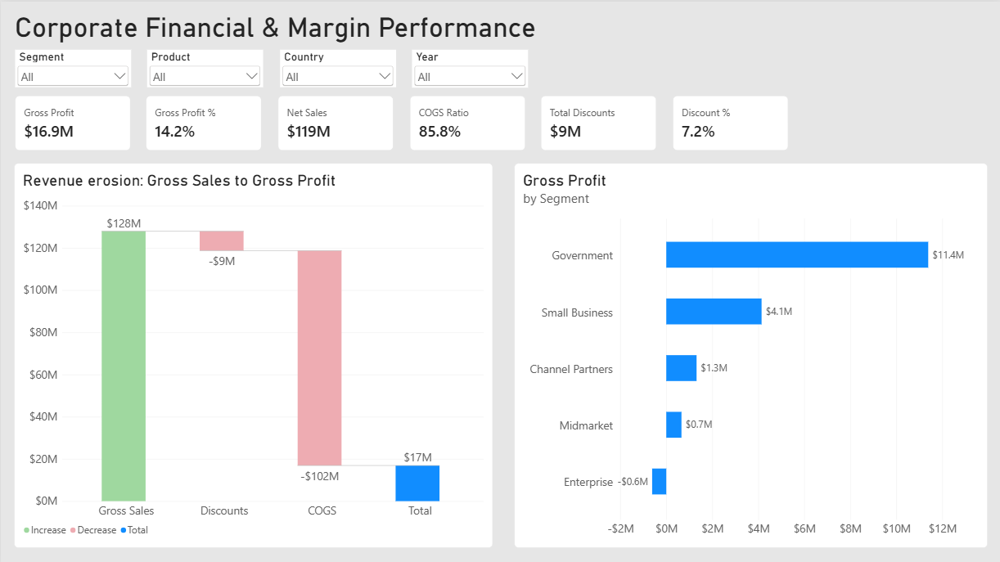
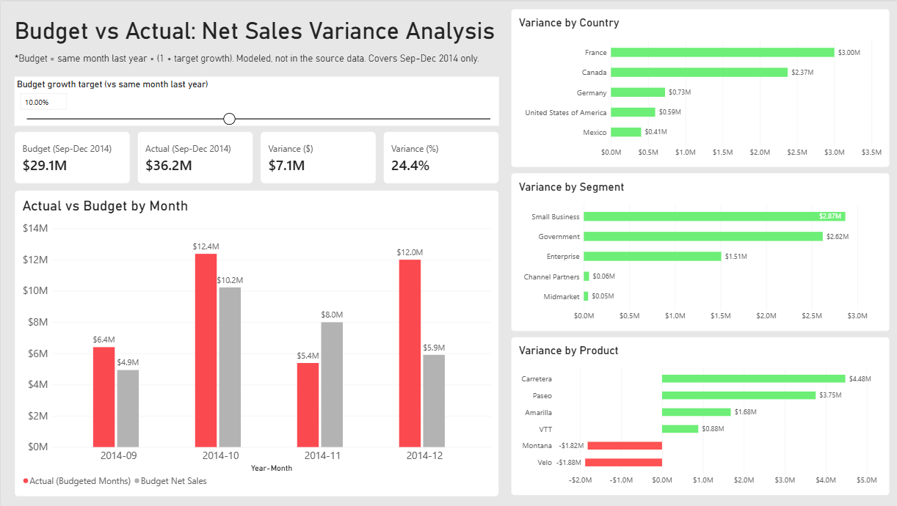
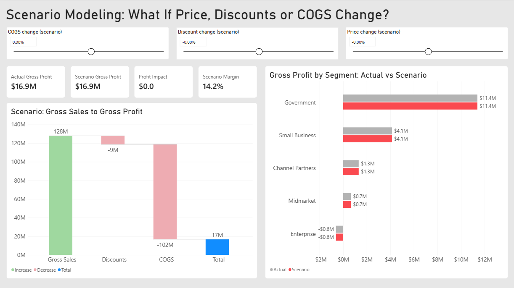

# Corporate Financial & Margin Performance Dashboard (Power BI)

## Executive Summary

I built a three-page interactive Power BI dashboard on the Microsoft Financial Sample dataset (700 rows, September 2013 to December 2014, six product lines, five segments, five countries). Gross sales are $127.9M, discounts take $9.2M (7.2%), net sales are $118.7M, COGS is $101.8M and gross profit is $16.9M, a 14.2% margin. The dashboard shows how revenue erodes from gross sales to gross profit, compares actual net sales with a modeled budget, and lets a user change price, discount and COGS with sliders to see the effect on profit. The main finding is that COGS, not discounting, is the largest source of erosion: it consumes about 86% of net sales, while discounts remove 7.2% of gross sales. Government earns 67% of all gross profit, and the Enterprise segment loses money (-3.1% margin) because its COGS is higher than its net sales.

## Business Problem

Management needs to see how much of each sales dollar survives discounts and manufacturing costs, whether actual sales are meeting target, and what would happen to profit if price, discounts or costs changed. The raw table has 700 rows of figures and no way to answer those questions quickly, so I turned it into an income statement view, a variance view and a scenario view that all respond to filters and sliders.

## Methodology

**Data preparation.** I loaded the `financials` table from the Excel file in Power Query, trimmed the column names and text values, and set the data types. Dates, month and year columns were converted, and the money columns were set to decimal numbers. I checked the row count (700), the date range (16 distinct months), the five countries and the four discount bands (None, Low, Medium, High).

**Star schema.** `FactFinancials` sits in the center with three one-to-many dimensions: `DimProduct` (6 rows), `DimSegment` (5 rows) and `DimCountry` (5 rows). `DimDate` is a DAX calendar covering 1 January 2013 to 31 December 2014 (730 rows), marked as the date table, with month names sorted by month number. All relationships are one-to-many with single-direction filtering. I hid the fact table's date columns so that every slicer and axis uses the dimension tables.

**Income statement measures.** Total Gross Sales, Total Discounts, Net Sales (Gross Sales - Discounts), Total COGS, Gross Profit (Net Sales - COGS), Gross Profit %, COGS Ratio, Discount %, Segment Margin and Margin vs Company. All ratios use `DIVIDE` to avoid division-by-zero errors.

**Budget and variance.** The dataset has no budget, so I modeled one: *Budget = net sales in the same month last year x (1 + target growth)*, where target growth is a what-if slider (default 10%). Because the data starts in September 2013, a prior-year month exists only for September to December 2014, so the budget covers those four months only. `Net Sales PY` uses `SAMEPERIODLASTYEAR`. The budget and actual measures use `SUMX` over months and count only months that have a budget, so the variance compares the same months on both sides at any filter level.

**Scenario modeling.** Three what-if sliders drive the scenario measures: price change (-10% to +10%), discount change (-50% to +50%) and COGS change (-20% to +20%). Scenario Gross Sales, Discounts, Net Sales, COGS and Gross Profit are rebuilt from the actuals, and Profit Impact and Margin Impact compare the scenario with the actual result. With every slider at 0%, the scenario equals the actuals.

**Validation.** On a hidden Validation page I checked that Gross Sales - Discounts - COGS equals the source Profit column and that Net Sales equals the source Sales column. Both checks return 0 after rounding to two decimals. I also tested each scenario slider against hand-calculated values.

**Report design.**

- Page 1, Income Statement: six KPI cards, a waterfall chart (Gross Sales, Discounts, COGS, Gross Profit), a Gross Profit by Segment bar chart, and slicers for segment, product, country and year.
- Page 2, Budget vs Actual: the target growth slider, four KPI cards, an Actual vs Budget column chart by month, and variance bar charts by country, segment and product, colored green for beating the budget and red for missing it.
- Page 3, Scenarios: the three sliders, four KPI cards, a scenario waterfall and an Actual vs Scenario gross profit chart by segment.

## Skills

Power BI Desktop, Power Query, star-schema data modeling, DAX (CALCULATE, SUMX, SAMEPERIODLASTYEAR, DIVIDE, SELECTEDVALUE, SWITCH, calendar tables), time intelligence, what-if parameters, waterfall charts, variance analysis, scenario modeling, conditional formatting, custom number formats, data validation, interactive dashboard design, communicating business insights.

## Results and Business Recommendations

**COGS is the biggest source of revenue erosion.** Of $127.9M in gross sales, discounts remove $9.2M (7.2%) and COGS removes $101.8M, leaving $16.9M of gross profit. COGS is 85.8% of net sales, so small changes in cost have a large effect on profit. I recommend reviewing manufacturing cost before looking at further discount cuts.

**Government is the profit engine; Enterprise is a loss.** Government earns $11.4M of gross profit (67% of the total) at a 21.7% margin. Small Business has $42.4M of net sales but only a 9.8% margin ($4.1M). Enterprise has $19.6M of net sales against $20.2M of COGS, a loss of $0.6M (-3.1%). Channel Partners has the highest margin (73.1%), but only $1.8M of net sales, so its profit is small. I recommend investigating Enterprise pricing and cost first.

**Sep to Dec 2014 beat the modeled budget.** At the default 10% growth target, the budget is $29.1M and actual net sales are $36.2M, a variance of +$7.1M (+24.4%). October (+$2.2M) and December (+$6.1M) were well above budget, September also beat it, and November missed it ($5.4M actual against $8.0M budget). The November miss and the large December beat mostly reflect how uneven the 2013 base month figures were, so I would not read them as a trend.

**Montana and Velo are below budget.** At the 10% target, Carretera (+$4.5M), Paseo (+$3.8M), Amarilla (+$1.7M) and VTT (+$0.9M) beat the budget, while Montana (-$1.8M) and Velo (-$1.9M) missed it. By country, France (+$3.0M) and Canada (+$2.4M) are the largest positive variances, and by segment Small Business (+$2.9M) and Government (+$2.6M) lead. I recommend reviewing the two product lines that missed.

**Price has the largest effect in the scenarios.** A 5% price increase raises gross profit from $16.9M to $22.8M (+$5.9M, margin from 14.2% to 18.3%) and moves Enterprise from a $0.6M loss to a $0.4M profit. A 10% increase in discount dollars lowers profit by about $0.9M, and a 5% increase in COGS lowers it by about $5.1M (margin 9.9%). Profit is far more sensitive to price and cost than to discount levels.

**Notes and limitations.** The Financial Sample is a fictional dataset, so these findings are practice results, not real business results.

- The budget is modeled, not provided. It depends on one prior year and on the target growth slider, so variances change when the slider moves.
- The budget covers only September to December 2014, because the data has no earlier prior-year months. Comparing full years would compare 4 months with 12.
- The scenarios are simple sensitivity tests, not forecasts. Units sold stay constant, so a price increase assumes no loss of volume, discounts scale with price, and COGS changes only through the COGS slider.

## Next Steps

I would test whether the product variances (Montana and Velo in particular) hold at other target growth settings, add a volume (units sold) slider so that price changes can include demand effects, and add a profit-by-discount-band view using the four discount bands. With a full prior year of data, I would replace the modeled budget with a real one and publish the report to the Power BI Service as a live dashboard.

## Files

- `financial_dashboard.pbix`: the Power BI report
- `financial_dashboard.pdf`: exported report pages
- `data/`: source file (`financial_sample.xlsx`)
- `images/`: dashboard screenshots used in this README

Note: the .pbix stores the file path of my local data folder. To open it elsewhere, go to Transform data → Data source settings → Change source, and point the source to `financial_sample.xlsx` in `data/`.